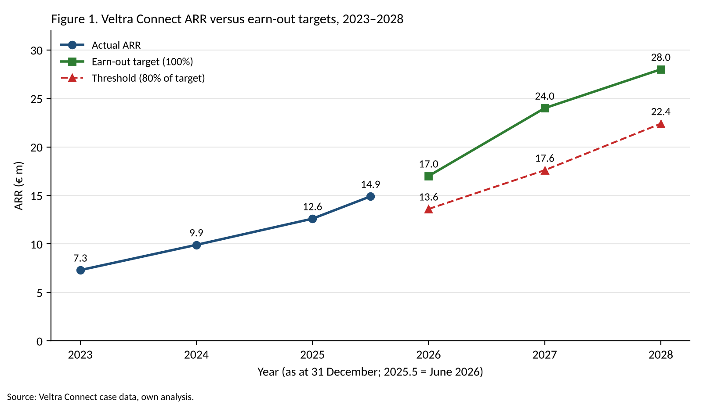

# Sold, but not yet paid

**An analysis of the earn-out in KPN's acquisition of Veltra Connect**

**Student:** Tim

## 1. Introduction

On 1 March 2026, KPN acquired all shares in Veltra Connect B.V., a Utrecht-based provider of IoT connectivity and sensor monitoring for care institutions, logistics companies and municipalities. Founder and sole shareholder Ruben Achterberg received €42 million at closing. In addition, he can earn up to €18 million through an earn-out, spread over three years and linked to the growth of Veltra's annual recurring revenue (ARR).

On paper, an earn-out seems an elegant solution: buyer and seller do not need to agree on the future, the future decides for itself. In practice, this very structure often leads to conflict, because after closing the seller no longer controls the company on which his payment depends (Cain et al., 2011).

The central question of this essay is therefore: **to what extent is the earn-out in the acquisition of Veltra Connect designed so that both KPN and the founder can realistically benefit from it, given the changes the acquisition brings to Veltra's sales process?**

I first discuss the strategic rationale (section 2), then the valuation and deal structure (section 3) and the design of the earn-out (section 4). In section 5 I analyse the sales pipeline using MEDDPICC, because whether the earn-out is achievable is ultimately decided in the pipeline. Section 6 contains the conclusion and a recommendation.

## 2. Strategic rationale

KPN has a large business customer base and its own network, but little specialist software on top of that connectivity. Veltra provides exactly that: a platform that turns sensor data, for example from fall detection in care homes or temperature monitoring in refrigerated transport, into alerts and reports. According to the case, 90% of Veltra's revenue (€12.6 million of €14.0 million in 2025) runs on KPN SIM cards. KPN already earns from Veltra, but only from the bottom layer.

The acquisition offers three kinds of synergy:

- **Revenue synergy through cross-selling.** KPN can offer the Veltra platform to its existing business customers. This is the main reason for the deal, but also the least certain: revenue synergies are overestimated more often in practice than cost synergies (Bruner, 2004).
- **Cost synergy.** Veltra currently pays a wholesale rate for connectivity. After the acquisition, that margin disappears within the group. Support functions such as HR and finance can also be merged.
- **Strategic synergy.** KPN wants to depend less on pure connectivity, where the price per connection has been falling for years. With Veltra, KPN buys a software layer with higher margins.

There is also the question of integration. Haspeslagh and Jemison (1991) distinguish between absorption, preservation and symbiosis. KPN has opted for a form of preservation: Veltra remains a separate company with its own brand, and Achterberg stays on as managing director for three years. That choice makes sense, because without the founder the technical knowledge and customer relationships would leave. At the same time, Veltra's sales team (eight people) is moved organisationally into KPN Business. So there is preservation at product level and partial absorption at sales level. I return to this in section 5, because it is precisely this partial absorption that affects the earn-out.

## 3. Valuation and deal structure

### 3.1 Valuation of the fixed purchase price

In 2025 Veltra had revenue of €14.0 million and EBITDA of €2.8 million (a 20% margin). Revenue grew from €8.1 million in 2023 to €14.0 million in 2025, an average annual growth of about 31%.

The fixed purchase price of €42 million amounts to:

| Measure | Value 2025 | Multiple fixed price (€42m) | Multiple maximum price (€60m) |
|---|---|---|---|
| Revenue | €14.0m | 3.0x | 4.3x |
| EBITDA | €2.8m | 15.0x | 21.4x |

For comparable transactions in IoT software, the case gives a range of 3 to 5 times revenue. The fixed price is therefore at the lower end of that range, and the maximum price including the earn-out in the middle. That fits a company that is growing fast but has only been operating at this scale for three years. I have not carried out a full DCF valuation, because the case gives no cash flow forecasts beyond 2028 and the terminal value would then determine most of the outcome (Koller et al., 2020).

### 3.2 The earn-out and its expected value

The earn-out consists of three tranches of up to €6 million each. Each tranche depends on ARR at the end of the year:

| Measurement date | ARR target | Growth vs previous target | Threshold (80%) |
|---|---|---|---|
| 31-12-2026 | €17.0m | +35% (vs €12.6m) | €13.6m |
| 31-12-2027 | €22.0m | +29% | €17.6m |
| 31-12-2028 | €28.0m | +27% | €22.4m |

Below 80% of the target nothing is paid; between 80% and 100% the payout increases linearly. There is also a condition: the EBITDA margin must be at least 15% in the year concerned.

Figure 1 compares actual ARR with the targets and thresholds.

What stands out in figure 1 is that the jump between the 2026 target and the 2027 target is the largest of the whole earn-out period: the target rises by more than 40%. The second tranche is therefore the hardest to achieve in full. At the same time, the figure shows that actual ARR so far is heading fairly straight towards the 2026 target, which makes the first tranche the most likely.

To calculate the expected value, I estimated for each tranche what share of the maximum is likely to be paid. For 2026 I estimate 80%: at the time of the case (June 2026) ARR already stands at €14.9 million, above the threshold, and two large deals in the pipeline would almost reach the target (see section 5). For 2027 and 2028 I estimate 60% and 40%, because the required growth remains high while the company grows larger. With a discount rate of 10%, which is customary for this kind of calculation, I arrive at the following:

| Tranche | Expected payout | Discount factor (10%) | Present value |
|---|---|---|---|
| 2026 | €4.8m | 1/1.10 | €4.36m |
| 2027 | €3.6m | 1/1.21 | €2.98m |
| 2028 | €2.4m | 1/1.331 | €1.80m |
| **Total** | **€10.8m** | | **€9.14m** |

The expected total consideration is therefore about €51.1 million, or 18.3 times 2025 EBITDA. Of the maximum €18 million earn-out, only slightly more than half is worth anything in expectation.

### 3.3 Why an earn-out?

Why did KPN and Achterberg not simply agree on a single fixed price of around €51 million? The literature offers three explanations, and all three apply here.

First, the **valuation gap**. Achterberg believes in 30% annual growth, KPN is more cautious. An earn-out lets both parties keep their own expectations: if the founder is proved right, KPN pays more (Kohers & Ang, 2000).

Second, **information asymmetry**. The seller knows more about the quality of the pipeline than the buyer. Datar et al. (2001) show that earn-outs are more common when the buyer has little insight into the target, for example with private companies in a different sector. That applies to KPN, which knew Veltra as a customer but not from the inside.

Third, **retaining the founder**. Kohers and Ang (2000) call this "agreeing to stay": the earn-out ties the founder to the company for as long as he is needed for growth.

## 4. Design, incentives and risks of the earn-out

### 4.1 The chosen measure

The earn-out is linked to ARR, not to EBITDA or net profit. This has a clear advantage: ARR is relatively hard to influence through accounting choices, because it concerns contractual revenue. Costs that KPN allocates to Veltra, for example for shared services, do not count. That protects the founder.

The disadvantage is that ARR rewards only growth, not profitable growth. Achterberg has an incentive to win customers with large discounts or long free periods, as long as the contract is signed before the measurement date. The 15% EBITDA condition limits this, but only as a floor: between a 15% and 20% margin, profitability may fall without consequences.

### 4.2 Conflicting incentives

This is a classic agency problem (Jensen & Meckling, 1976). After closing, KPN is the owner (principal), but Achterberg runs the company (agent) and is rewarded on a measure that does not fully coincide with the value for KPN. Two conflicts are clearly visible in this case:

- **Short term versus long term.** Investments in product development that only generate revenue after 2028 cost Achterberg margin now and earn him nothing. He therefore has an incentive to postpone them until after the earn-out period.
- **Integration versus autonomy.** KPN wants to bundle the Veltra platform with its own services as quickly as possible. But when a customer buys a KPN bundle, it is not obvious how much of that revenue should be attributed to Veltra. The more KPN integrates, the harder the earn-out becomes to measure.

### 4.3 Risk of disputes after closing

Cain et al. (2011) show that most earn-out disputes are not about whether the target was met, but about whether the buyer made it impossible for the seller to meet it. In this case there are three concrete risks:

1. **Control over the sales team.** The sales team falls under KPN Business. If KPN gives that team other priorities, Achterberg cannot meet his targets, without being able to do anything about it.
2. **Pricing policy.** The case mentions that KPN has its own discount policy for large business customers. If that also applies to Veltra, ARR per customer falls.
3. **Revenue attribution.** As described above: with bundles it is unclear which part of the revenue belongs to Veltra.

To limit these risks, I propose the following contractual safeguards:

- an **attribution rule** that sets in advance what percentage of a bundle price counts as Veltra ARR;
- an **operational covenant** from KPN that the sales team spends at least 80% of its time on Veltra products during the earn-out period;
- a **dispute resolution clause** with an independent accountant who gives a binding ruling within 60 days, so that a conflict does not block the collaboration for months.

## 5. Sales and integration: a MEDDPICC analysis of the pipeline

Whether the earn-out is paid is ultimately determined by whether the large deals in the pipeline are signed on time. To analyse this I use MEDDPICC, a qualification method from enterprise sales. The letters stand for Metrics, Economic buyer, Decision criteria, Decision process, Paper process, Identify pain, Champion and Competition. I apply the method to the three largest deals in the pipeline.

### 5.1 Deal A: Lindehof care group (expected ARR €1.1m)

Lindehof is a care group with 40 locations that wants to roll out fall detection and night-time monitoring.

- **Metrics:** fewer night-time checking rounds; the case mentions a saving of 18 FTE in night shifts.
- **Economic buyer:** the executive board, because the investment exceeds the IT manager's spending authority.
- **Decision criteria and process:** a pilot at three locations has been completed, after which the executive board decides.
- **Paper process:** this is where the problem lies. Before the acquisition, Lindehof signed Veltra's standard agreement. Now the contract has to go through KPN's legal department, with KPN terms and a more extensive data processing agreement. The case states that the contract phase takes 10 weeks on average at KPN, compared with 3 weeks at Veltra.
- **Identify pain:** staff shortages on night shifts.
- **Champion:** the care innovation manager who led the pilot.
- **Competition:** a competing provider of care home technology.

### 5.2 Deal B: Van Dorsten Transport (expected ARR €0.8m)

Van Dorsten wants temperature monitoring in 220 refrigerated trucks.

- **Metrics:** fewer rejected loads.
- **Identify pain:** a customer is threatening to cancel its contract after two incidents with spoiled cargo.

According to the case, the deal is in the negotiation phase.

### 5.3 Deal C: a medium-sized municipality (expected ARR €0.6m)

The municipality wants sensors in underground waste containers and the sewer system.

- **Decision process and paper process:** the contract exceeds the European tender threshold, so a public tender will follow. It will not be completed before 2027.
- **Competition:** remarkably, one of the competitors in this tender is KPN itself. KPN's Public Sector division already supplies connectivity to this municipality and is bidding with its own smart city solution from a partner. It is unclear whether KPN will submit one bid or two.
- **Economic buyer:** the alderman responsible for public space.

### 5.4 What the analysis shows

The analysis shows that the acquisition changes Veltra's sales process in three ways.

First, the **paper process** becomes longer. For deal A, seven extra weeks of contracting means the deal may only be signed in January 2027 instead of November 2026. Its ARR of €1.1 million would then not count towards the first tranche. If deals A and B both close on time, ARR at the end of 2026 reaches €16.8 million, 94% of the target, worth about €5.6 million. If only deal B closes, ARR reaches €15.7 million, about 62% of the maximum tranche, or €3.7 million. The difference of almost €2 million for the founder therefore depends on the speed of the buyer's legal department.

Second, the **champion relationship** shifts. At Lindehof, the champion was used to dealing directly with Achterberg. Contact now runs through a KPN Business account manager. That makes the deal more vulnerable.

Third, there is **competition within the group**. In deal C, Veltra competes with another division of its own parent company. If the partner solution from KPN Public Sector wins, that is no loss for KPN, but it is for Achterberg's earn-out.

The analysis also shows that the earn-out targets in the contract have been set separately from the sales process that is supposed to deliver them. The 2026 target was achievable under Veltra's old paper process, but much less so under KPN's terms.

## 6. Conclusion and recommendation

The central question was to what extent the earn-out is designed so that both KPN and the founder can realistically benefit from it. My conclusion is: **partly**. Choosing ARR as the measure protects the founder against accounting manipulation by the buyer, and the earn-out bridges a genuine valuation gap. But the contract does not take into account the effects of integration on the sales process. The longer paper process, the shifted champion relationships and the internal competition are largely beyond Achterberg's control, yet they determine whether he receives his earn-out. As a result, the expected value of the earn-out (€9.1 million) is well below the maximum of €18 million.

My recommendation to both parties is to supplement the contract on two points. First, an **attribution rule for bundles and internal competition**: if KPN wins a deal for which Veltra was also competing, a pre-agreed share counts as Veltra ARR. Second, a **measurement rule based on signed intent**: a deal for which a written award has been received before the measurement date counts, even if the contract is signed afterwards.

In addition, KPN should consider converting part of the earn-out into a retention bonus that does not depend on ARR, so that Achterberg remains motivated even if the target moves out of reach.

One limitation of this analysis is that the probability estimates per tranche rest on my own judgement. A different estimate gives a different expected value, although it does not change the conclusion about the design.

## References

Bruner, R. F. (2004). *Applied mergers and acquisitions*. John Wiley & Sons.

Cain, M. D., Denis, D. J., & Denis, D. K. (2011). Earnouts: A study of financial contracting in acquisition agreements. *Journal of Accounting and Economics, 51*(1–2), 151–170.

Datar, S., Frankel, R., & Wolfson, M. (2001). Earnouts: The effects of adverse selection and agency costs on acquisition techniques. *Journal of Law, Economics, and Organization, 17*(1), 201–238.

Haspeslagh, P. C., & Jemison, D. B. (1991). *Managing acquisitions: Creating value through corporate renewal*. Free Press.

Jensen, M. C., & Meckling, W. H. (1976). Theory of the firm: Managerial behavior, agency costs and ownership structure. *Journal of Financial Economics, 3*(4), 305–360.

Kohers, N., & Ang, J. (2000). Earnouts in mergers: Agreeing to disagree and agreeing to stay. *The Journal of Business, 73*(3), 445–476.

Koller, T., Goedhart, M., & Wessels, D. (2020). *Valuation: Measuring and managing the value of companies* (7th ed.). Wiley.
