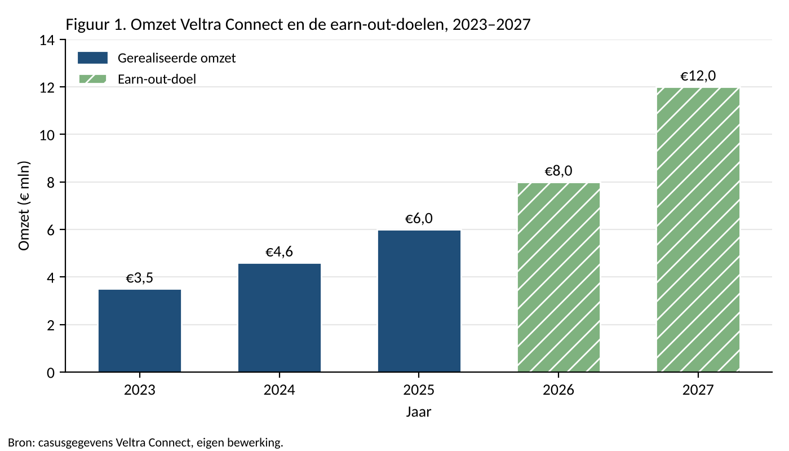

_Fictieve inzending, gemaakt op 2026-11-10 als oefenmateriaal voor `beoordelingsformulier-ma-earn-out-simpel` en `-simpel-beschreven`. Veltra Connect, de founder, de klant en alle cijfers zijn verzonnen; de overname door KPN heeft niet plaatsgevonden. De bronnen bestaan wel. Bewuste fouten: (1) in figuur 1 staat het doel voor 2027 op €12,0 mln in plaats van €10,0 mln, en de student concludeert daaruit ten onrechte dat 2027 de grootste stap is (in werkelijkheid +25%, kleiner dan de +33% van 2026); (2) de kans van 50% voor 2027 wordt niet onderbouwd; (3) MEDDPICC wordt zonder bron gebruikt. Deze toelichting hoort niet bij de inzending: de .docx is zonder._

## 1. Inleiding

Ruben Achterberg richtte in 2019 Veltra Connect op, een bedrijf dat sensoren en software levert aan zorginstellingen. Een sensor in een verpleeghuis ziet bijvoorbeeld dat een bewoner 's nachts valt en stuurt meteen een melding naar de nachtdienst. In maart 2026 verkocht Ruben zijn bedrijf aan KPN.

KPN betaalde niet alles in één keer. Ruben kreeg 18 miljoen euro direct, en kan nog 6 miljoen euro extra krijgen als Veltra de komende twee jaar genoeg groeit. Zo'n afspraak heet een earn-out.

Mijn hoofdvraag is: **hoe groot is de kans dat Ruben zijn earn-out van 6 miljoen euro echt ontvangt, nu KPN de eigenaar is?**

## 2. Wat is een earn-out?

Bij een earn-out betaalt de koper een deel van de prijs pas later, en alleen als het bedrijf vooraf afgesproken doelen haalt (Bruner, 2004). Het doel is meestal een bepaalde omzet of winst in een bepaald jaar.

KPN en Ruben kozen om twee redenen voor een earn-out:

- **Ze waren het niet eens over de waarde.** Ruben verwacht dat Veltra elk jaar ongeveer 30% blijft groeien en vond 24 miljoen euro een eerlijke prijs. KPN rekende voorzichtiger. Met een earn-out hoeven ze het niet eens te worden: als Ruben gelijk krijgt, betaalt KPN meer (Kohers & Ang, 2000).
- **KPN wil dat Ruben blijft.** Ruben kent de klanten en de techniek. Als hij na de verkoop vertrekt, is Veltra minder waard. Door de earn-out heeft hij een reden om twee jaar te blijven en hard te werken.

## 3. Wat kan Ruben verdienen?

De earn-out bestaat uit twee delen van elk 3 miljoen euro. Een deel wordt alleen betaald als de omzet in dat jaar het doel haalt. Wordt het doel net niet gehaald, dan krijgt Ruben voor dat jaar niets.

| Jaar | Omzetdoel | Uitbetaling als het doel gehaald wordt |
|---|---|---|
| 2026 | €8,0 mln | €3 mln |
| 2027 | €10,0 mln | €3 mln |

In 2025 had Veltra een omzet van 6,0 miljoen euro. Figuur 1 laat de omzet van de afgelopen jaren zien naast de twee doelen.

In figuur 1 is goed te zien dat het doel voor 2027 de grootste stap vraagt: van 8 naar 12 miljoen euro is een groei van 50%. Het doel voor 2026 is veel haalbaarder, omdat de omzet de afgelopen jaren al met ongeveer 30% per jaar groeide.

Maximaal ontvangt Ruben dus 6 miljoen euro, en in totaal 18 + 6 = 24 miljoen euro. Maar hoeveel kan hij verwachten? Daarvoor schat ik per jaar de kans dat het doel gehaald wordt:

| Jaar | Kans | Verwachte uitbetaling |
|---|---|---|
| 2026 | 70% | 0,70 × €3 mln = €2,1 mln |
| 2027 | 50% | 0,50 × €3 mln = €1,5 mln |
| **Totaal** | | **€3,6 mln** |

De kans voor 2026 schat ik op 70%, omdat er één grote deal in de pijplijn zit die het doel bijna alleen kan halen (zie paragraaf 5). Voor 2027 schat ik de kans op 50%. Naar verwachting krijgt Ruben dus 3,6 miljoen euro van de 6 miljoen.

## 4. Risico's voor Ruben

Na de verkoop is Ruben niet meer de baas. KPN is de eigenaar, en dat brengt risico's met zich mee:

- **Het salesteam valt nu onder KPN.** De acht verkopers van Veltra werken nu bij KPN Zakelijk. Als KPN ze ook andere producten laat verkopen, groeit de omzet van Veltra minder hard.
- **KPN bepaalt de prijzen.** Als KPN grote klanten korting geeft, daalt de omzet van Veltra, terwijl Ruben daar niets over te zeggen heeft.

Om het eerste risico kleiner te maken, kan in het contract staan dat het salesteam de komende twee jaar alleen Veltra-producten verkoopt.

## 5. Sales: de grote deal met Zorggroep Lindehof

Of Ruben zijn earn-out krijgt, hangt sterk af van één deal: Zorggroep Lindehof, een zorgorganisatie met 40 locaties. Als die deal in 2026 getekend wordt, levert dat 1,5 miljoen euro omzet per jaar op. Om deze deal te beoordelen gebruik ik MEDDPICC, een methode uit de sales om te bepalen hoe kansrijk een deal is.

- **Metrics (wat levert het op?):** Lindehof kan 18 nachtdiensten per week schrappen, omdat de sensoren de controlerondes overnemen.
- **Economic buyer (wie tekent?):** de raad van bestuur van Lindehof.
- **Paper process (hoe komt het contract rond?):** voor de overname tekende een klant het korte contract van Veltra, dat duurde ongeveer 3 weken. Nu moet het contract langs de juristen van KPN, en dat duurt ongeveer 10 weken.
- **Champion (wie helpt ons intern?):** de manager zorginnovatie van Lindehof, die de proef op drie locaties heeft geleid.
- **Competition (wie is de concurrent?):** een andere aanbieder van zorgsensoren.

Het grootste risico is het paper process. Lindehof wil in oktober 2026 beslissen. Met 3 weken contracttijd was de deal ruim voor het einde van het jaar rond geweest. Met 10 weken wordt het eind december, of zelfs januari 2027. Als de deal pas in januari getekend wordt, telt de omzet niet mee voor 2026 en komt Veltra waarschijnlijk niet aan 8 miljoen. Dan mist Ruben 3 miljoen euro, alleen door de langere contracttijd bij KPN.

## 6. Conclusie en advies

Mijn hoofdvraag was hoe groot de kans is dat Ruben zijn earn-out van 6 miljoen euro echt ontvangt. Naar verwachting ontvangt hij ongeveer 3,6 miljoen euro, dus iets meer dan de helft. De grootste bedreiging is niet dat Veltra slecht presteert, maar dat KPN nu bepaalt hoe snel contracten rond komen, wat het salesteam doet en welke prijzen er gelden.

Mijn advies aan Ruben is om met KPN af te spreken dat een deal meetelt voor de earn-out zodra de klant schriftelijk "ja" heeft gezegd, ook als het contract pas later getekend wordt. Dan verliest hij geen 3 miljoen euro door de langere contracttijd van KPN.

## Bronnen

Bruner, R. F. (2004). *Applied mergers and acquisitions*. John Wiley & Sons.

Kohers, N., & Ang, J. (2000). Earnouts in mergers: Agreeing to disagree and agreeing to stay. *The Journal of Business, 73*(3), 445–476.
